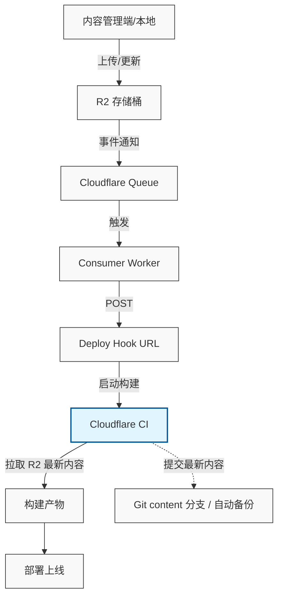

# 基于 Cloudflare 的自动化静态内容发布

在构建现代静态站点（如 Astro、VitePress、Next.js 等）时，我们经常面临这样一个需求：**内容需要频繁更新，且希望将内容存储与代码逻辑分离**。

Cloudflare 提供了一套极佳的 Serverless 方案：使用 **R2** 作为无出口费用的对象存储，利用 **Worker** 作为触发器，结合 **Cloudflare Pages/Workers Builds** 进行自动化构建，最后通过 **Git** 实现内容备份。

本文将详细拆解这套架构的实现过程，并附上生产环境中踩坑后的终极解决方案。

## 架构流程图



---

## 核心步骤实现

### 1. 内容存储：Cloudflare R2
将你的 Markdown 文件、图片或其他静态资源存入 R2 存储桶中。R2 最大的优势是**零出口流量费**，非常适合作为静态站点的源数据仓库。

为了方便 CI 拉取，你需要配置好 R2 的 API Token，并在 CI 环境中注入 `R2_ACCESS_KEY_ID` 和 `R2_SECRET_ACCESS_KEY`。

### 2. 事件触发：Cloudflare Queues
由于直接通过 R2 触发 Webhook 容易因为高并发导致请求超载，最佳实践是使用 Cloudflare Queues 进行消息缓冲。

在 `wrangler.jsonc` 中配置队列消费者：

```jsonc
{
  "queues": {
    "consumers": [
      {
        "queue": "r2-content-build",
        "max_batch_size": 10,
        "max_batch_timeout": 5
      }
    ]
  }
}
```

### 3. 触发构建：Queue Consumer Worker
编写一个 Worker 来消费队列消息，并调用 Cloudflare 提供的 Deploy Hook。

> **⚠️ 避坑指南：**
> 1. 确保 `DEPLOY_HOOK_URL` 已在 Worker 的环境变量中正确配置。
> 2. Cloudflare 的 Deploy Hook 有防抖/去重机制（如果上一次构建还在排队，新的请求会返回同一个 build_uuid），所以无需担心短时间内多次触发。

```javascript
export default {
  async queue(batch, env, ctx) {
    console.log(`Received ${batch.messages.length} R2 update notifications.`);

    try {
      const res = await fetch(env.DEPLOY_HOOK_URL, { method: "POST" });

      if (!res.ok) {
        throw new Error(`Build hook failed with status: ${res.status}`);
      }
      
      console.log("Deploy hook triggered successfully.");
      for (const msg of batch.messages) msg.ack();
      
    } catch (err) {
      console.error("Failed to trigger hook:", err.message);
      // 失败后延迟重试
      for (const msg of batch.messages) {
        msg.retry({ delaySeconds: 60 });
      }
    }
  }
};
```

### 4. 自动化构建与 Git 备份：CI 脚本 (`sync.sh`)

当 Deploy Hook 触发 Cloudflare 构建时，CI 环境会执行 `sync.sh` 脚本。在这个阶段，我们需要完成三件事：**拉取 R2 内容** -> **合并主分支代码** -> **构建并推送到 Git 备份分支**。

> **⚠️ 避坑指南（血泪史）：**
> 1. **CI 环境是浅克隆**：本地往往没有 `master` 分支，必须使用 `origin/${CURRENT_BRANCH}` 进行合并。
> 2. **Detached HEAD**：CI 默认不处于任何分支上，`git branch --show-current` 结果为空，需使用环境变量 `WORKERS_CI_BRANCH` 兜底。
> 3. **工作区冲突**：直接 `fetch` 到当前检出的分支会报错，使用 `git checkout -B` 强制重置是更稳妥的做法。

下面是修改后的终极 `sync.sh` 脚本：

```bash
#!/usr/bin/env bash
set -e # 遇到错误立即退出（除了部分允许容错的命令）

# 1. 配置 Git 凭证 (用于后续 Push 备份)
git remote set-url origin "https://<username>:${GITHUB_TOKEN}@github.com/<user>/<repo>.git"
git config user.name "Deploy Bot"
git config user.email "bot@example.com"

# 2. 获取当前触发分支（防止 CI 环境为 detached HEAD）
CURRENT_BRANCH="${WORKERS_CI_BRANCH:-master}"

if git ls-remote --exit-code --heads origin content; then
  echo "Pulling content branch, merging origin/${CURRENT_BRANCH} into content..."
  
  git fetch origin content
  # 强制新建/重置本地 content 分支并切换到该分支
  git checkout -B content origin/content
  
  # 在 CI 中，本地没有 master，必须合并 origin/master
  if git rev-parse --verify "origin/${CURRENT_BRANCH}" >/dev/null 2>&1; then
    git merge "origin/${CURRENT_BRANCH}" -X theirs
  fi
else
  echo "Initializing content branch..."
  git checkout -b content
fi

# 3. 从 R2 拉取最新内容
node worker/build/pull-r2.js

# 4. 执行项目构建 (确保配置的 assets.directory 与此处产物对应，如 dist)
pnpm build

# 5. 将 R2 最新内容提交并备份到 Git 的 content 分支
git add src/content
# 如果没有变动，不报错
git commit -m "Auto-sync R2 content (Build Verified) [skip ci]" || echo "No changes to commit"

# 推送备份
git push origin content || echo "Push failed, continuing deployment..."
```

---

## 补充优化与部署检查清单

### 1. 解决 `dist` 目录不存在报错
如果在 `wrangler.jsonc` 中配置了 `"assets": { "directory": "./dist" }`，但在部署时抛出 `[ERROR] The directory specified by the "assets.directory" field in your configuration file does not exist`：
* 检查框架的默认构建输出目录。例如 Astro 是 `dist`，Next.js (静态导出) 是 `out`，Nuxt 是 `.output/public`。
* 确保 `pnpm build` 在 `sync.sh` 中正确执行且未中断。

### 2. 处理 Wrangler 警告
如果在部署时看到类似 `Unexpected fields found in observability field: "issue_detection"` 的警告，只需去 `wrangler.jsonc` 中将过时的字段删除即可，这不影响核心部署。

### 3. CI 中的 `[skip ci]` 后缀
在提交备份记录时，强烈建议在 commit message 中加上 `[skip ci]` 或 `[no ci]`（取决于你使用的 Git 平台）。这样可以避免 CI 机器人推送备份内容到 Git 后，再次触发新的构建流水线，造成死循环。

## 总结

这套架构将**内容（R2）**、**代码（Git 主分支）**、**构建逻辑（CI）** 和**备份（Git content 分支）**完美解耦。你只需向 R2 上传文件，剩下的内容同步、代码合并、静态构建、版本备份都将全自动无缝完成，同时还能享受 Cloudflare 极低的成本和高并发能力。